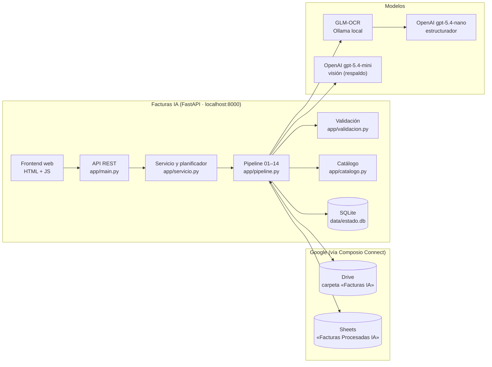

# Facturas IA

> Procesamiento automático de facturas (PDF e imágenes) desde Google Drive, con extracción por IA, validación de montos, cruce con catálogo y registro en Google Sheets.


---

## Tabla de contenido

- [Descripción](#descripción)
- [Características](#características)
- [Arquitectura](#arquitectura)
- [Flujo de procesamiento](#flujo-de-procesamiento)
- [Requisitos](#requisitos)
- [Instalación](#instalación)
- [Configuración](#configuración)
- [Uso](#uso)
- [API REST](#api-rest)
- [Pruebas](#pruebas)
- [Estructura del proyecto](#estructura-del-proyecto)
- [Seguridad](#seguridad)
- [Solución de problemas](#solución-de-problemas)
- [Limitaciones conocidas](#limitaciones-conocidas)
- [Documentación relacionada](#documentación-relacionada)

---

## Descripción

**Facturas IA** vigila la carpeta **«Facturas IA»** de Google Drive y procesa, una por una, las facturas que se suben a ella. Para cada archivo:

1. Extrae los datos con una **cadena de modelos de IA**: GLM-OCR en local (gratis, vía Ollama) + `gpt-5.4-nano` para estructurar; si falla, el respaldo **OpenAI `gpt-5.4-mini` con visión**.
2. **Valida** el resultado contra un esquema JSON configurable y comprueba que los montos cuadren (líneas, subtotal, descuentos, impuestos y total).
3. **Cruza** cada línea con el catálogo de productos y calcula el *total catálogo*.
4. **Registra** todo en la hoja de Google Sheets **«Facturas Procesadas IA»** (pestañas *Facturas*, *Detalle* y *Errores*).
5. **Mueve** el archivo a la subcarpeta **Procesadas** o, si los datos no son confiables, a **Revisión manual** con el motivo exacto.

Si ningún modelo está disponible, el proceso **se detiene** y la factura queda pendiente: una caída del servicio no dice nada sobre la factura, así que nunca se manda a revisión por eso.

Toda la operación se controla desde una aplicación web local (panel, detalle de facturas y configuración).

## Características

| Área | Capacidades |
|------|-------------|
| **Entrada** | PDF (con o sin capa de texto), JPG, PNG y WEBP. Otros tipos se ignoran y se quedan en la carpeta. |
| **Extracción** | Cadena de modelos configurable, hasta 3 intentos por factura con escalamiento al modelo más robusto y *pistas* sobre lo que falló. Si el PDF trae texto, se salta el OCR. |
| **Validación** | Esquema JSON editable, salida estructurada estricta, cuadre de montos con tolerancias de redondeo, umbral de confianza y detección de documentos que no son facturas. |
| **Duplicados** | Por huella del archivo (md5) y por emisor + número de factura ya registrados. |
| **Catálogo** | Coincidencia por código exacto, palabra clave/sinónimo y parecido de texto (rapidfuzz ≥ 85). Importación desde CSV. |
| **Resultados** | Google Sheets con tres pestañas; columnas nuevas al final si el esquema crece. Exportable a Excel desde Drive. |
| **Resiliencia** | Escritura idempotente (cada fila lleva el ID del archivo), movimiento solo después de registrar, recuperación de facturas «en proceso» tras un corte, reintentos ante el límite de cuota (429) de Google. |
| **Operación** | Procesamiento manual o automático con frecuencia y franja horaria, bitácora por paso, alertas en el panel y prueba de extracción con archivos locales. |
| **Pruebas** | Modo *Carpeta local* que imita Drive, generador de 11 documentos de prueba y pruebas de punta a punta con modelos reales. |

## Arquitectura



**Componentes principales**

- **Backend**: Python 3.13 + FastAPI, servido con Uvicorn. Un único proceso sirve la API y el frontend.
- **Estado**: SQLite (`data/estado.db`) con archivos, corridas, bitácora y alertas.
- **Configuración**: `data/config.json`, editable desde la app y con valores por defecto.
- **Almacenamiento**: interfaz común (`app/storage/base.py`) con dos implementaciones: Google Drive + Sheets mediante **Composio Connect** (MCP, cabecera `x-consumer-api-key`) y una **carpeta local** para pruebas.
- **Extracción**: interfaz común (`app/extraction/base.py`) con errores tipados: `ErrorProveedor` (el modelo no responde, puede detener la corrida) y `ErrorDocumento` (el documento no da datos, cuenta como intento fallido).

El diagrama interactivo completo está en [diseno/flujo-facturas-ia.html](diseno/flujo-facturas-ia.html) y también en la app, pestaña *Diagrama*.

## Flujo de procesamiento

| Paso | Nombre | Qué hace |
|------|--------|----------|
| 01 | Vigilar carpeta | Localiza «Facturas IA» y crea *Procesadas* y *Revisión manual* si faltan. Se detiene si hay dos carpetas con el mismo nombre. |
| 02 | Detectar nuevos | Lista los archivos, ignora los tipos no admitidos y detecta duplicados exactos (md5). |
| 03 | Cola | Ordena las pendientes y respeta el máximo por corrida. |
| 04 | Descargar y preparar | Descarga y convierte a imágenes (PDF a 150 dpi, máximo 5 páginas) o usa la capa de texto. |
| 05 | Extracción IA | Modelo primario: GLM-OCR + estructurador. |
| 06 | Modelo de respaldo | Reintentos con el siguiente modelo de la cadena y una pista de lo que falló. |
| 07 | Validar esquema | Campos obligatorios, tipos y formato. |
| 08 | Cuadre de montos | `cantidad × precio − descuento = importe`, `Σ importes = subtotal`, `subtotal − descuento + impuestos + otros = total`. |
| 09 | ¿Datos confiables? | Esquema + cuadre + confianza ≥ 0,6 + es factura. |
| 10 | Cruce con catálogo | Coincidencia de cada línea con los productos. |
| 11 | Total catálogo | Suma de las líneas del catálogo (sin impuestos por defecto). |
| 12 | Registrar en la hoja | Agrega filas en *Facturas* y *Detalle*; detecta duplicados por emisor + número. |
| 13 | Mover a Procesadas | Solo después de que las filas quedaron escritas. |
| R | Mover a Revisión | Datos no confiables: registra el motivo en *Errores* y mueve el archivo. |
| 14 | Contar archivos | Actualiza los contadores del panel. |

## Requisitos

- **Windows** con **Python 3.13** (versión probada) y conexión a internet.
- **[Ollama](https://ollama.com)** con el modelo `glm-ocr` (2,2 GB). Funciona en CPU: unos 45–60 s por página de imagen. Los PDF con capa de texto no necesitan OCR.
- **API key de OpenAI**, usada por el estructurador y por el modelo de respaldo.
- **API key de Composio Connect** (`ck_…`) con **Google Drive** y **Google Sheets** conectados en [composio.dev](https://composio.dev).

## Instalación

```powershell
git clone <url-del-repositorio> "Procesamiento de facturas IA"
cd "Procesamiento de facturas IA"
python -m venv .venv
.venv\Scripts\python -m pip install -r requirements.txt
ollama pull glm-ocr
```

## Configuración

### Claves

Copia la plantilla y completa las claves:

```powershell
Copy-Item .env.example .env
```

| Variable | Descripción |
|----------|-------------|
| `OPENAI-APIKEY` | API key de OpenAI. También acepta `OPENAI_APIKEY` u `OPENAI_API_KEY`. |
| `COMPOSIO-APIKEY` | API key de Composio Connect (`ck_…`). También acepta `COMPOSIO_APIKEY` o `COMPOSIO_API_KEY`. |
| `FACTURAS_IA_DATA` | *(Opcional)* carpeta de datos; por defecto `data/`. |

Las claves también se pueden escribir en la app (**Configuración → API keys**); en ese caso se guardan cifradas en `data/secretos.enc` y tienen prioridad sobre el `.env`.

### Opciones de la aplicación

Todo lo demás se edita en **Configuración** y se guarda en `data/config.json` (se crea solo al primer arranque):

| Sección | Qué controla | Valor por defecto |
|---------|--------------|-------------------|
| Conexión | Proveedor (`composio` o carpeta local), nombres de carpetas y de la hoja | «Facturas IA», «Procesadas», «Revisión manual», «Facturas Procesadas IA» |
| Frecuencia | Revisión automática, intervalo, franja horaria, máximo por corrida | Apagada · 20 por corrida |
| Modelos | Cadena de modelos, intentos, reintentos técnicos, timeout | GLM-OCR local → OpenAI visión · 3 intentos · 240 s |
| Esquema | Campos de la factura (tabla o JSON Schema) | Número, fecha, emisor, receptor, moneda, líneas, totales |
| Validación | Tolerancias, confianza mínima, precios con impuesto | 0,02 por línea · 0,05 en totales · 0,6 de confianza |
| Catálogo | Productos, palabras clave, umbral de parecido, total con impuesto | 5 productos de ejemplo · umbral 85 |

## Uso

Inicia el servidor:

```powershell
.venv\Scripts\python -m uvicorn app.main:app --host 127.0.0.1 --port 8000
```

Abre <http://localhost:8000>:

- **Panel**: pendientes, procesadas y en revisión; botón *Procesar ahora*, paso en curso, últimas corridas, alertas y bitácora.
- **Facturas**: cada archivo con su estado. Al abrirlo se ven los datos extraídos, las líneas con su coincidencia en el catálogo, las reglas de validación, los intentos por modelo y el texto OCR.
- **Configuración**: todas las opciones anteriores, más *Probar conexión*, *Probar extracción* con un archivo del equipo y prueba de descripciones contra el catálogo.
- **Diagrama**: flujo interactivo del proceso.

## API REST

| Método | Ruta | Descripción |
|--------|------|-------------|
| `GET` | `/api/estado` | Contadores, corrida en curso, alertas activas. |
| `POST` | `/api/procesar` | Inicia una corrida en segundo plano. |
| `POST` | `/api/detener` | Detiene la corrida al terminar la factura en curso. |
| `GET` | `/api/corridas` | Historial de corridas. |
| `GET` | `/api/eventos` | Bitácora de eventos por paso. |
| `GET` | `/api/archivos` | Archivos conocidos y su estado. |
| `GET` | `/api/archivos/{file_id}` | Detalle de un archivo: datos, validación, intentos y OCR. |
| `POST` | `/api/alertas/{alerta_id}/cerrar` | Cierra una alerta. |
| `GET` | `/api/config` | Configuración completa. |
| `PUT` | `/api/config/{seccion}` | Guarda una sección (con validación). |
| `POST` | `/api/config/{seccion}/restablecer` | Vuelve una sección a sus valores por defecto. |
| `GET` | `/api/secretos` | Estado de las claves (enmascaradas, nunca completas). |
| `PUT` / `DELETE` | `/api/secretos/{nombre}` | Guarda (cifrada) o borra una clave. |
| `POST` | `/api/probar/drive` | Prueba la conexión con Drive y Sheets. |
| `GET` | `/api/modelos/ollama` | Modelos instalados en Ollama. |
| `POST` | `/api/probar/extraccion` | Extrae y valida un archivo subido, sin registrarlo. |
| `POST` | `/api/probar/catalogo` | Prueba descripciones contra el catálogo. |

La documentación interactiva de FastAPI está disponible en <http://localhost:8000/docs>.

## Pruebas

```powershell
# Pruebas unitarias (sin red): números, fechas, cuadre, catálogo, esquema y reglas de la cadena de modelos
.venv\Scripts\python -m pytest tests -q

# Generar los 11 documentos de prueba
.venv\Scripts\python tests\generar_documentos.py

# Punta a punta con modelos reales sobre una carpeta local simulada
.venv\Scripts\python tests\e2e.py local

# Punta a punta en Google Drive: subir los documentos de prueba y procesarlos
.venv\Scripts\python scripts\subir_pruebas_drive.py
.venv\Scripts\python tests\e2e.py drive

# Simulación de caída de todos los modelos
.venv\Scripts\python tests\e2e_caida.py
```

**Documentos de prueba** (`tests/docs/`, resultado esperado en `esperado.json`):

| Documento | Caso | Resultado esperado |
|-----------|------|--------------------|
| `factura_01_ferreteria.pdf` | PDF con capa de texto | Procesada |
| `factura_02_distribuidora.jpg` | Foto JPG | Procesada |
| `factura_03_papeleria.png` | PNG sin productos del catálogo | Procesada |
| `factura_04_escaneada.pdf` | PDF escaneado, descuento impreso en negativo | Procesada |
| `factura_06_descuentos.jpg` | Descuentos por línea y generales | Procesada |
| `factura_05_totales_erroneos.pdf` | Los montos no cuadran | Revisión manual |
| `foto_borrosa.jpg` | Ilegible | Revisión manual |
| `documento_protegido.pdf` | PDF con contraseña | Revisión manual |
| `no_es_factura.jpg` | Documento que no es factura | Revisión manual |
| `factura_01_copia.pdf` | Duplicado exacto | Revisión manual |
| `notas.txt` | Tipo no admitido | Ignorado |

## Estructura del proyecto

```
.
├── app/
│   ├── main.py              API (FastAPI) y servidor del frontend
│   ├── pipeline.py          flujo completo, pasos 01–14, revisión y detención
│   ├── servicio.py          corridas en segundo plano y planificador
│   ├── validacion.py        esquema, cuadre de montos y decisión
│   ├── catalogo.py          coincidencia con el catálogo y total catálogo
│   ├── configuracion.py     configuración editable con valores por defecto
│   ├── secretos.py          API keys cifradas (Fernet)
│   ├── settings.py          rutas del proyecto y lectura de .env
│   ├── db.py                estado en SQLite (archivos, corridas, bitácora, alertas)
│   ├── extraction/          preparación del documento, GLM-OCR, OpenAI e instrucciones
│   └── storage/             Drive + Sheets vía Composio, y carpeta local para pruebas
├── web/                     frontend (HTML, CSS y JS sin dependencias)
├── tests/                   pruebas unitarias, generador de documentos y pruebas de punta a punta
├── scripts/                 utilidades: subir documentos de prueba a Drive, ver la hoja
├── diseno/                  diagrama interactivo del flujo
├── data/                    (se crea solo, no se versiona) config.json, estado.db, secretos
├── .env.example             plantilla de claves
├── CHANGELOG.md             historial de cambios
├── DECISIONES.md            registro de decisiones de diseño
└── requirements.txt         dependencias de Python
```

## Seguridad

- La app escucha **solo en `localhost`** y no tiene inicio de sesión: está pensada para uso personal en un equipo. Para exponerla en red hay que agregar autenticación.
- Las claves escritas en la app se guardan **cifradas** (Fernet); el navegador nunca recibe una clave completa.
- `.env` y `data/` están excluidos del control de versiones.
- En Google Drive el sistema opera **únicamente** sobre la carpeta «Facturas IA» y sus subcarpetas; antes de descargar o mover un archivo comprueba que sigue dentro de ella.

## Solución de problemas

| Síntoma | Causa probable | Qué hacer |
|---------|----------------|-----------|
| Aviso «Proceso detenido: ningún modelo disponible» | Ollama apagado, API key inválida o sin saldo | Revisa el error de cada modelo en el aviso; inicia Ollama (`ollama serve`) o corrige la clave. Las facturas siguen pendientes. |
| El OCR tarda más de un minuto por página | GLM-OCR corre en CPU | Es esperado; reduce `lado_maximo_px` en la configuración del modelo o usa PDFs con capa de texto. |
| Error 429 de Google Sheets | Límite de lecturas por minuto | El sistema reintenta solo (15, 30 y 60 s). Reduce el máximo por corrida si se repite. |
| «Hay dos carpetas llamadas Facturas IA» | Nombre ambiguo en Drive | Renombra o elimina una de ellas. |
| Una factura correcta va a revisión | Tolerancias demasiado estrictas o catálogo incompleto | Revisa las reglas de validación en el detalle de la factura y ajusta *Configuración → Validación*. |

## Limitaciones conocidas

- Los avisos se muestran solo en el panel; no se envían correos.
- Se procesan como máximo 5 páginas por documento.
- El catálogo inicial es de ejemplo y coincide con los documentos de prueba.

## Documentación relacionada

- [CHANGELOG.md](CHANGELOG.md): historial de versiones.
- [DECISIONES.md](DECISIONES.md): las 36 decisiones de diseño, con su motivo y dónde se cambian.
- [diseno/flujo-facturas-ia.html](diseno/flujo-facturas-ia.html): diagrama interactivo del flujo.
