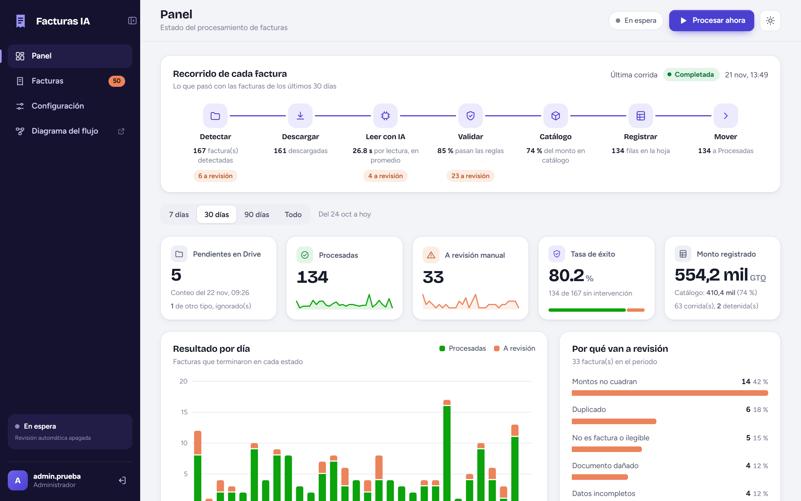
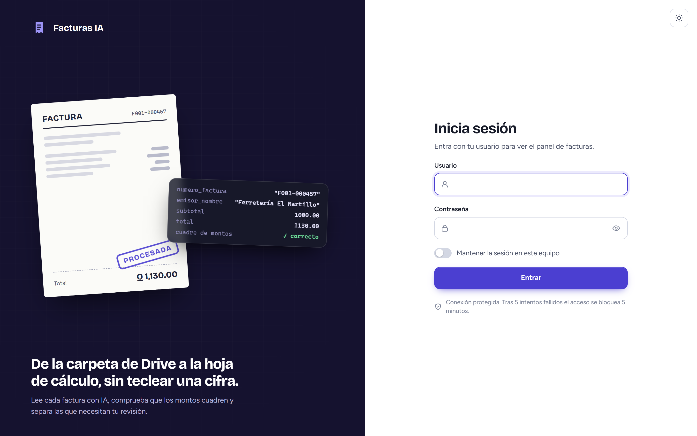
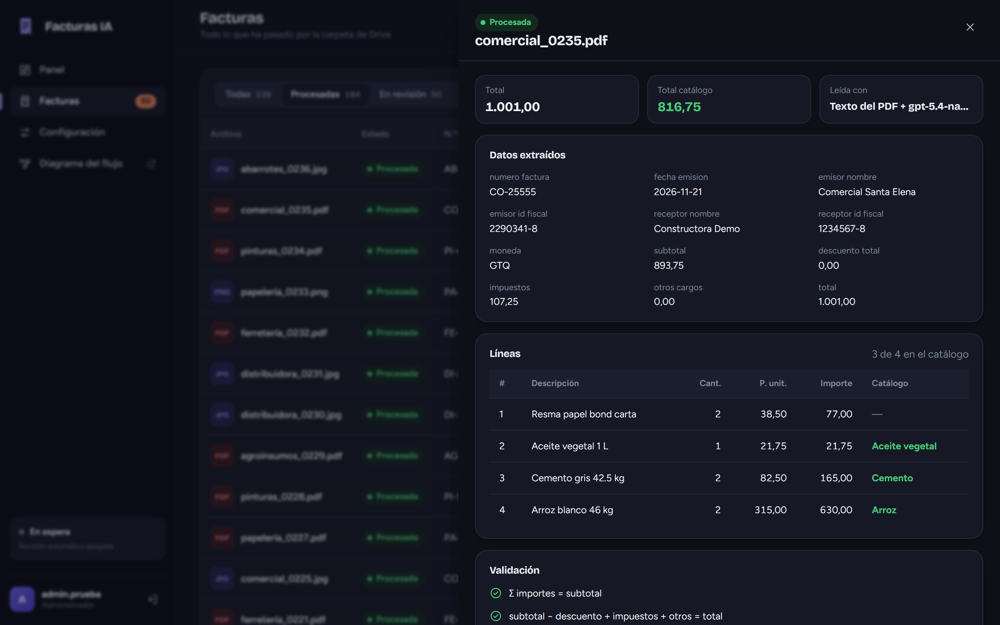
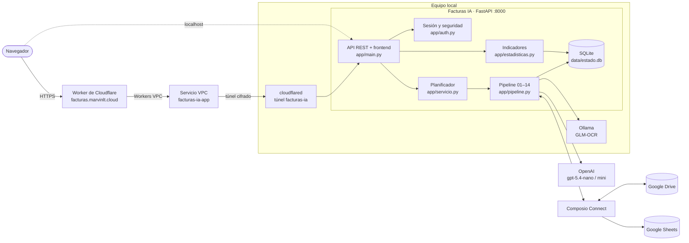

<div align="center">

# Facturas IA

**Procesamiento automático de facturas: de la carpeta de Google Drive a Google Sheets, sin teclear una cifra.**

Lee cada factura (PDF o imagen) con IA, comprueba que los montos cuadren, la cruza con tu catálogo de productos, la registra en una hoja de cálculo y separa las que necesitan revisión manual.

[](CHANGELOG.md)
[](tests/frontend/REPORTE_PRUEBAS.md)

[](https://www.python.org)
[](https://fastapi.tiangolo.com)
[](https://www.uvicorn.org)
[](https://www.sqlite.org)
[](https://platform.openai.com)
[](https://ollama.com)
<br>
[](https://drive.google.com)
[](https://sheets.google.com)
[](https://composio.dev)
[](https://www.cloudflare.com/products/tunnel/)
[](web/)
[](tests/frontend/)

</div>

---

## Capturas

<table>
  <tr>
    <td colspan="2"></td>
  </tr>
  <tr>
    <td width="50%"></td>
    <td width="50%"></td>
  </tr>
  <tr>
    <td colspan="2" align="center"><sub>Panel principal (tema claro) · Inicio de sesión · Detalle de una factura (tema oscuro). Datos de demostración.</sub></td>
  </tr>
</table>

## Contenido

- [Qué hace](#qué-hace)
- [Características](#características)
- [Arquitectura](#arquitectura)
- [Flujo de procesamiento](#flujo-de-procesamiento)
- [Requisitos](#requisitos)
- [Instalación](#instalación)
- [Configuración](#configuración)
- [Ejecución](#ejecución)
- [Publicación en Cloudflare](#publicación-en-cloudflare)
- [La interfaz](#la-interfaz)
- [API REST](#api-rest)
- [Pruebas](#pruebas)
- [Estructura del proyecto](#estructura-del-proyecto)
- [Seguridad](#seguridad)
- [Solución de problemas](#solución-de-problemas)
- [Documentación relacionada](#documentación-relacionada)

## Qué hace

Subes facturas a la carpeta **«Facturas IA»** de Google Drive. Para cada archivo, el sistema:

1. **Extrae los datos** con una cadena de modelos de IA: GLM-OCR en local (gratis, vía Ollama) + `gpt-5.4-nano` para ordenarlos; si falla, el respaldo **OpenAI `gpt-5.4-mini` con visión**.
2. **Valida** el resultado contra un esquema JSON configurable y comprueba que los montos cuadren: líneas, subtotal, descuentos, impuestos y total.
3. **Cruza** cada línea con el catálogo de productos y calcula el *total catálogo*.
4. **Registra** todo en la hoja **«Facturas Procesadas IA»** de Google Sheets, con las pestañas *Facturas*, *Detalle* y *Errores*.
5. **Mueve** el archivo a **Procesadas** o, si los datos no son confiables, a **Revisión manual** con el motivo exacto.

Si ningún modelo está disponible, el proceso **se detiene** y la factura queda pendiente: una caída del servicio no dice nada de la factura, así que nunca la manda a revisión.

## Características

| Área | Capacidades |
|------|-------------|
| **Entrada** | PDF con o sin capa de texto, JPG, PNG y WEBP. Los demás tipos se ignoran y se quedan en la carpeta. |
| **Extracción** | Cadena de modelos configurable, hasta 3 intentos por factura, escalando al modelo más robusto con una pista de lo que falló. Si el PDF trae texto, se salta el OCR. |
| **Validación** | Esquema JSON editable, salida estructurada estricta, cuadre de montos con tolerancias de redondeo, umbral de confianza y detección de documentos que no son facturas. |
| **Duplicados** | Por huella del archivo (md5) y por emisor + número de factura. |
| **Catálogo** | Coincidencia por código, palabra clave o sinónimo y parecido de texto. Importación desde CSV. |
| **Panel** | Recorrido de la factura en 7 etapas con la etapa en curso en vivo; indicadores con tendencia; gráficos de resultados por día, motivos de revisión y rendimiento por modelo; corridas y bitácora con filtros y búsqueda. |
| **Facturas** | Tabla con filtros por estado, búsqueda, orden por columna, paginación, exportación a CSV y detalle completo en un panel lateral. |
| **Interfaz** | Inicio de sesión, menú lateral contraíble, tema claro y oscuro, diseño adaptable a escritorio, tableta y móvil, y navegación con teclado. |
| **Resiliencia** | Escritura idempotente, movimiento solo después de registrar, recuperación tras un corte y reintentos ante el límite de cuota de Google. |
| **Publicación** | En <https://facturas.marvinlt.cloud> con un Worker de Cloudflare, Workers VPC y un túnel: HTTPS y sin abrir puertos. |

## Arquitectura



| Capa | Tecnología |
|------|------------|
| Backend | Python 3.13, FastAPI y Uvicorn. Un único proceso sirve la API, el frontend y el planificador. |
| Estado | SQLite (`data/estado.db`): archivos, corridas, bitácora, alertas, usuarios y sesiones. |
| Frontend | HTML, CSS y JavaScript sin dependencias ni compilación. Gráficos SVG propios (`web/graficos.js`). |
| IA | GLM-OCR en Ollama (local, CPU) y OpenAI con salida estructurada estricta. |
| Google | Drive y Sheets mediante Composio Connect (MCP), limitado a la carpeta «Facturas IA». |
| Publicación | Worker de Cloudflare con dominio propio, Workers VPC y Cloudflare Tunnel, gestionados con Wrangler (`deploy/cloudflare/`). |

El diagrama interactivo del flujo está en [diseno/flujo-facturas-ia.html](diseno/flujo-facturas-ia.html), y en la app, en *Diagrama del flujo*.

## Flujo de procesamiento

| Paso | Nombre | Qué hace |
|------|--------|----------|
| 01 | Vigilar carpeta | Localiza «Facturas IA» y crea *Procesadas* y *Revisión manual* si faltan. |
| 02 | Detectar nuevos | Lista los archivos, ignora los tipos no admitidos y detecta duplicados exactos. |
| 03 | Cola | Ordena las pendientes y respeta el máximo por corrida. |
| 04 | Descargar y preparar | Descarga y convierte a imágenes (PDF a 150 dpi, máximo 5 páginas) o usa la capa de texto. |
| 05 | Extracción IA | Modelo primario: GLM-OCR + estructurador. |
| 06 | Modelo de respaldo | Reintenta con el siguiente modelo de la cadena y una pista de lo que falló. |
| 07 | Validar esquema | Campos obligatorios, tipos y formato. |
| 08 | Cuadre de montos | Líneas, subtotal y total con tolerancias de redondeo. |
| 09 | ¿Datos confiables? | Esquema, cuadre, confianza ≥ 0,6 y que sea una factura. |
| 10–11 | Catálogo | Coincidencia de cada línea y *total catálogo*. |
| 12 | Registrar en la hoja | Filas en *Facturas* y *Detalle*; detecta duplicados por emisor + número. |
| 13 / R | Mover | A *Procesadas*, o a *Revisión manual* con el motivo en la pestaña *Errores*. |
| 14 | Contar archivos | Actualiza los contadores del panel. |

## Requisitos

| Requisito | Para qué |
|-----------|----------|
| **Windows** con **Python 3.13** | Versión probada. |
| **[Ollama](https://ollama.com)** con el modelo `glm-ocr` (2,2 GB) | OCR gratis en local. En CPU tarda unos 45–60 s por página de imagen; los PDF con texto no lo necesitan. |
| **API key de OpenAI** | Estructurador y modelo de respaldo. |
| **API key de Composio Connect** (`ck_…`) | Con Google Drive y Google Sheets conectados en [composio.dev](https://composio.dev). |
| *Opcional:* **[Wrangler](https://developers.cloudflare.com/workers/wrangler/)** con la sesión iniciada y un dominio en Cloudflare | Publicar el sistema en internet. Wrangler descarga `cloudflared` solo. |
| *Opcional:* Microsoft Edge o Google Chrome | Pruebas de la interfaz con Playwright. |

## Instalación

```powershell
git clone https://github.com/Marvinilt/Analisis_Facturas_IA.git
cd Analisis_Facturas_IA
python -m venv .venv
.venv\Scripts\python -m pip install -r requirements.txt
ollama pull glm-ocr
```

Para desarrollar y correr las pruebas de la interfaz:

```powershell
.venv\Scripts\python -m pip install -r requirements-dev.txt
```

## Configuración

### 1. Claves

```powershell
Copy-Item .env.example .env
```

| Variable | Descripción |
|----------|-------------|
| `OPENAI-APIKEY` | API key de OpenAI. También acepta `OPENAI_APIKEY` u `OPENAI_API_KEY`. |
| `COMPOSIO-APIKEY` | API key de Composio Connect (`ck_…`). También acepta `COMPOSIO_APIKEY` o `COMPOSIO_API_KEY`. |
| `FACTURAS_IA_DATA` | *(Opcional)* Carpeta de datos. Por defecto, `data/`. |

Las claves también se pueden escribir en la app, en **Configuración → Modelos y API keys** o **Conexión**. Ahí se guardan cifradas en `data/secretos.enc` y tienen prioridad sobre el `.env`.

### 2. Cuenta de administrador

La primera vez que abres `http://localhost:8000` **en el mismo equipo**, la pantalla de acceso te pide crear la cuenta. Por seguridad, esa pantalla no está disponible a través de Cloudflare. También puedes crearla, o cambiar la contraseña, desde la terminal:

```powershell
.venv\Scripts\python -m app.auth crear-usuario admin
```

La contraseña debe tener al menos 10 caracteres.

### 3. Opciones de la aplicación

Todo lo demás se edita en **Configuración** y se guarda en `data/config.json`, que se crea solo:

| Sección | Qué controla | Por defecto |
|---------|--------------|-------------|
| Conexión | Origen (Google Drive o carpeta local de pruebas) y API key de Composio | Google Drive |
| Carpetas y hoja | Nombres de la carpeta de entrada, las subcarpetas y la hoja de resultados | «Facturas IA», «Procesadas», «Revisión manual», «Facturas Procesadas IA» |
| Frecuencia | Revisión automática, intervalo, franja horaria y máximo por corrida | Apagada · 20 por corrida |
| Modelos y API keys | Cadena de modelos, intentos, reintentos y tiempo máximo | GLM-OCR local → OpenAI visión · 3 intentos · 240 s |
| Esquema de factura | Campos que se extraen (tabla o JSON Schema) | Número, fecha, emisor, receptor, moneda, líneas y totales |
| Reglas de validación | Tolerancias, confianza mínima y precios con impuesto | 0,02 por línea · 0,05 en totales · 0,6 de confianza |
| Catálogo de productos | Productos, palabras clave, umbral de parecido | 5 productos de ejemplo · umbral 85 |
| Probar extracción | Prueba un archivo de tu equipo sin tocar Drive | — |

## Ejecución

```powershell
ollama serve   # si Ollama no está corriendo como servicio
.venv\Scripts\python -m uvicorn app.main:app --host 127.0.0.1 --port 8000
```

Abre <http://localhost:8000>, inicia sesión y usa **Procesar ahora**, o activa la revisión automática en **Configuración → Frecuencia**.

> La app escucha solo en `127.0.0.1`. Para entrar desde otros equipos, publícala con Cloudflare Tunnel; no la expongas con `--host 0.0.0.0`.

## Publicación en Cloudflare

**En línea:** <https://facturas.marvinlt.cloud>, protegido por el inicio de sesión.

El sistema necesita Ollama, SQLite y un planificador en segundo plano, así que no puede correr dentro de Cloudflare. Lo que se publica es el equipo donde ya funciona, sin abrir puertos en el router:

```
navegador ─HTTPS─► Worker «facturas-ia» ─► Workers VPC «facturas-ia-app» ─► túnel «facturas-ia» ─► 127.0.0.1:8000
                   (facturas.marvinlt.cloud)
```

- El **Worker** ([deploy/cloudflare/](deploy/cloudflare/)) atiende el dominio propio y reenvía cada petición por **Workers VPC**. Fija las cabeceras `CF-Connecting-IP`, `X-Forwarded-For`, `X-Forwarded-Proto` y `X-Forwarded-Host`, pisando lo que mande el cliente: con ellas la app sabe que la petición viene de internet. Si el equipo está apagado, muestra una página de «no disponible».
- El **túnel** abre una conexión de salida desde el equipo hacia Cloudflare.
- El dominio propio del Worker crea su registro DNS solo, así que **no hace falta permiso para editar DNS**.

**Una sola vez** (con `wrangler login` hecho):

```powershell
.\scripts\publicar_cloudflare.ps1 -Configurar
```

Crea el túnel y el servicio VPC si no existen, escribe el ID del servicio en `deploy/cloudflare/wrangler.jsonc` y despliega el Worker. Para otro dominio, cambia `routes` en ese archivo.

**Cada vez que enciendas el equipo** (con la app ya corriendo):

```powershell
.\scripts\publicar_cloudflare.ps1
```

Conecta el túnel hasta que pulses Ctrl+C. Para una capa más de protección, puedes poner [Cloudflare Access](https://developers.cloudflare.com/cloudflare-one/applications/) delante del dominio.

## La interfaz

| Pantalla | Qué muestra |
|----------|-------------|
| **Inicio de sesión** | Acceso con usuario y contraseña, creación de la primera cuenta y bloqueo tras 5 intentos fallidos. |
| **Panel** | Recorrido de la factura en 7 etapas, con cuántas se desvían a revisión en cada una y la etapa en curso cuando hay una corrida. Indicadores de pendientes, procesadas, en revisión, tasa de éxito y monto registrado, con la tendencia diaria. Gráficos de resultados por día, motivos de revisión y rendimiento por modelo. Corridas filtrables y bitácora con filtro por nivel y búsqueda. Filtro de periodo: 7, 30 o 90 días, o todo. |
| **Facturas** | Todas las facturas con su estado, filtros, búsqueda, orden y paginación. Exportación a CSV. Al abrir una: totales, motivo de revisión, datos extraídos, líneas con su producto del catálogo, reglas de validación, intentos por modelo, texto OCR y bitácora. |
| **Configuración** | Las ocho secciones descritas en [Configuración](#3-opciones-de-la-aplicación). |

En la barra superior están el estado del proceso, **Procesar ahora** y, en la esquina derecha, el **cambio de tema claro u oscuro**. El menú lateral se contrae con el botón junto al logo, y en móvil se abre con el botón de menú.

## API REST

Todas las rutas, salvo `/api/auth/*`, requieren sesión.

| Método | Ruta | Descripción |
|--------|------|-------------|
| `GET` | `/api/auth/estado` | Si hay sesión y si falta crear la primera cuenta. |
| `POST` | `/api/auth/login` | Inicia sesión (`usuario`, `clave`, `recordar`). |
| `POST` | `/api/auth/configurar` | Crea la primera cuenta. Solo desde el mismo equipo. |
| `POST` | `/api/auth/logout` | Cierra la sesión. |
| `GET` | `/api/estado` | Servicio, contadores, alertas y última corrida. |
| `GET` | `/api/estadisticas?dias=30` | Indicadores del panel (`dias=0` para todo). |
| `POST` | `/api/procesar` · `/api/detener` | Inicia una corrida o la detiene tras la factura en curso. |
| `GET` | `/api/corridas` · `/api/eventos` | Historial de corridas y bitácora. |
| `GET` | `/api/archivos` · `/api/archivos/{id}` | Facturas y el detalle de una. |
| `POST` | `/api/alertas/{id}/cerrar` | Descarta una alerta. |
| `GET` · `PUT` · `POST` | `/api/config` · `/api/config/{sección}` · `/restablecer` | Lee, guarda o restablece la configuración. |
| `GET` · `PUT` · `DELETE` | `/api/secretos` · `/api/secretos/{nombre}` | Estado de las claves (siempre enmascaradas), guardar o borrar. |
| `POST` | `/api/probar/drive` · `/extraccion` · `/catalogo` | Pruebas de conexión, extracción y catálogo. |
| `GET` | `/api/modelos/ollama` | Modelos instalados en Ollama. |

Con sesión iniciada, la documentación interactiva está en `/docs`.

## Pruebas

```powershell
# Unitarias (sin red): números, fechas, cuadre, catálogo, cadena de modelos e inicio de sesión
.venv\Scripts\python -m pytest tests -q

# Interfaz de punta a punta con un navegador real: 23 casos en escritorio, tableta y móvil, con capturas
.venv\Scripts\python tests\frontend\probar_frontend.py

# Procesamiento de punta a punta con modelos reales, en una carpeta local simulada o en Google Drive
.venv\Scripts\python tests\generar_documentos.py
.venv\Scripts\python tests\e2e.py local
.venv\Scripts\python scripts\subir_pruebas_drive.py
.venv\Scripts\python tests\e2e.py drive
.venv\Scripts\python tests\e2e_caida.py
```

El reporte de la interfaz, con los casos, las capturas y los defectos corregidos, está en [tests/frontend/REPORTE_PRUEBAS.md](tests/frontend/REPORTE_PRUEBAS.md). Para ver el panel con datos sin tocar los reales:

```powershell
.venv\Scripts\python tests\frontend\datos_demo.py C:\temp\facturas-demo
$env:FACTURAS_IA_DATA = "C:\temp\facturas-demo"; .venv\Scripts\python -m uvicorn app.main:app --port 8001
```

## Estructura del proyecto

```
.
├── app/
│   ├── main.py              API (FastAPI), protección de rutas y servidor del frontend
│   ├── auth.py              usuarios, contraseñas (scrypt), sesiones y límite de intentos
│   ├── estadisticas.py      indicadores y series del panel
│   ├── pipeline.py          flujo completo, pasos 01–14, revisión y detención
│   ├── servicio.py          corridas en segundo plano y planificador
│   ├── validacion.py        esquema, cuadre de montos y decisión
│   ├── catalogo.py          coincidencia con el catálogo y total catálogo
│   ├── configuracion.py     configuración editable con valores por defecto
│   ├── secretos.py          API keys cifradas (Fernet)
│   ├── settings.py          rutas del proyecto y lectura de .env
│   ├── db.py                estado en SQLite
│   ├── extraction/          preparación del documento, GLM-OCR, OpenAI e instrucciones
│   └── storage/             Drive y Sheets vía Composio, y carpeta local para pruebas
├── web/
│   ├── index.html           estructura de la app e iconos SVG
│   ├── styles.css           sistema visual, temas claro y oscuro, diseño adaptable
│   ├── app.js               acceso, rutas, panel, facturas y configuración
│   └── graficos.js          gráficos SVG sin dependencias
├── tests/
│   ├── test_unidad.py       pruebas unitarias del procesamiento
│   ├── test_auth.py         pruebas de inicio de sesión y protección de la API
│   ├── frontend/            pruebas de la interfaz, datos de demostración, capturas y reporte
│   └── docs/                11 documentos de prueba y resultados esperados
├── scripts/                 subir pruebas a Drive, ver la hoja y publicar en Cloudflare
├── deploy/cloudflare/       Worker que publica la app en el dominio propio
├── diseno/                  diagrama interactivo del flujo
├── docs/capturas/           capturas del README
├── data/                    (se crea solo, no se versiona) configuración, estado y secretos
├── CHANGELOG.md · DECISIONES.md · requirements.txt · requirements-dev.txt · .env.example
```

## Seguridad

- **Inicio de sesión obligatorio.** Contraseñas con scrypt, cookie `HttpOnly` y `SameSite=Lax` (y `Secure` por HTTPS), sesiones de 12 horas y bloqueo de 5 minutos tras 5 intentos fallidos.
- **La primera cuenta solo se crea desde el mismo equipo**, nunca a través del túnel.
- Peticiones que modifican datos desde otro origen rechazadas, y cabeceras `X-Frame-Options`, `X-Content-Type-Options` y `Referrer-Policy`.
- Claves de API cifradas en reposo; el navegador nunca recibe una completa.
- La app escucha solo en `127.0.0.1`; el acceso externo pasa por Cloudflare con HTTPS.
- En Google Drive opera **únicamente** sobre la carpeta «Facturas IA» y sus subcarpetas.
- `.env` y `data/` no se versionan.

## Solución de problemas

| Síntoma | Causa probable | Qué hacer |
|---------|----------------|-----------|
| «Proceso detenido: ningún modelo disponible» | Ollama apagado, API key inválida o sin saldo | Revisa el error de cada modelo en la alerta; inicia Ollama o corrige la clave. Las facturas siguen pendientes. |
| «Falta crear la cuenta» al entrar por el subdominio | Todavía no hay cuenta | Créala en `http://localhost:8000` desde el equipo, o con `python -m app.auth crear-usuario`. |
| «Demasiados intentos» | 5 contraseñas incorrectas en 5 minutos | Espera 5 minutos. Si la olvidaste, cámbiala con `python -m app.auth crear-usuario <usuario>`. |
| El subdominio muestra «Facturas IA no está disponible ahora» | El túnel o la app no están corriendo | Inicia la app y luego `.\scripts\publicar_cloudflare.ps1`. |
| El OCR tarda más de un minuto por página | GLM-OCR corre en CPU | Es lo esperado; reduce el lado máximo de imagen del modelo o usa PDF con texto. |
| Error 429 de Google Sheets | Límite de lecturas por minuto | El sistema reintenta solo; baja el máximo por corrida si se repite. |

## Documentación relacionada

- [CHANGELOG.md](CHANGELOG.md): historial de versiones.
- [DECISIONES.md](DECISIONES.md): las 47 decisiones de diseño, con su motivo y dónde se cambian.
- [tests/frontend/REPORTE_PRUEBAS.md](tests/frontend/REPORTE_PRUEBAS.md): pruebas de la interfaz y defectos corregidos.
- [diseno/flujo-facturas-ia.html](diseno/flujo-facturas-ia.html): diagrama interactivo del flujo.
